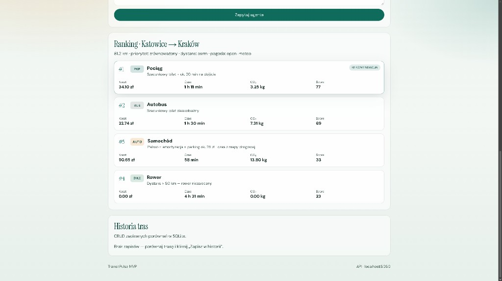

# TransitPulse

Narzędzie decyzyjne A→B: porównuje **samochód, pociąg, autobus i rower** pod kątem kosztu, czasu i emisji CO₂, a następnie zwraca ranking dopasowany do priorytetu (`najtaniej` / `najszybciej` / `najzieleniej` / `zrównoważony`).

**Creative twist — TransitPulse AI:** wpisujesz po ludzku (np. *„Jutro rano muszę być w Krakowie z Katowic, mam 2h, nie chcę płacić za parking”*), lokalny agent wyciąga trasę i ograniczenia, dokłada pogodę i zwraca rekomendację z uzasadnieniem. Działa **bez klucza LLM** (heurystyki + scoring).

## Funkcje

- Porównanie 4 środków transportu (koszt, czas, CO₂, score)
- Wyszukiwanie miast (seed PL + **Open-Meteo Geocoding**) + podpowiedzi w UI
- Dystans/czas: **OSRM**, a gdy padnie — haversine × 1.3
- Pogoda z **Open-Meteo** (wpływ na rower), fallback do mocka
- Priorytet użytkownika + parking / limit czasu / limit roweru
- Agent AI (parser NL PL)
- CRUD historii tras w SQLite
- CORS FE ↔ BE

## Stack

| Warstwa | Technologia |
|---------|-------------|
| Backend | Java 17, Spring Boot 3, Spring Data JPA, SQLite |
| Frontend | React, Vite, TypeScript |
| AI (produkt) | lokalny `NlPreferenceParser` (bez LLM / bez klucza) |
| Dane zewnętrzne | Open-Meteo Geocoding + Weather, OSRM — bez kluczy |
| Fallback | seed PL → haversine×1.3 → mock pogody |
| Poza zakresem MVP | scraping Koleo / live ceny stacji — bilety = model km, paliwo = średnia w configu |

## Struktura

```
backend/      API REST (port 8080)
frontend/     UI (port 5173)
.cursor/      reguły Cursor
AGENTS.md     opis konfiguracji agenta
demo/         nagranie / zrzuty ekranu
```

## Uruchomienie lokalne

Wymagania: **JDK 17+**, **Maven 3.9+**, **Node.js 20+**.

### 1. Backend (API)

```bash
cd backend
mvn spring-boot:run
```

API: `http://localhost:8080`

Endpointy:

- `POST /api/compare` — ranking środków transportu
- `POST /api/agent/advise` — rekomendacja z naturalnego języka
- `GET /api/cities/search?q=` — podpowiedzi miast
- `GET|POST|PUT|DELETE /api/trips` — CRUD historii

### 2. Frontend

W drugim terminalu:

```bash
cd frontend
npm install
npm run dev
```

UI: `http://localhost:5173`

## Demo

<video src="demo/demo.mp4" controls width="720" poster="demo/01-ranking.png">
  <a href="demo/demo.mp4">Obejrzyj nagranie (demo.mp4)</a>
</video>

Jeśli odtwarzacz się nie pojawi, otwórz plik bezpośrednio: [demo/demo.mp4](demo/demo.mp4).

Zrzut ekranu — ranking:



## Jak wspierałem się narzędziami AI

- **Cursor** — scaffold monorepo, warstwy Spring Boot, UI React, integracje OSRM/Open-Meteo, refaktor copy i parsera NL.
- W produkcie **nie** ma zewnętrznego LLM — agent to lokalna heurystyka, żeby MVP działało bez klucza API.
